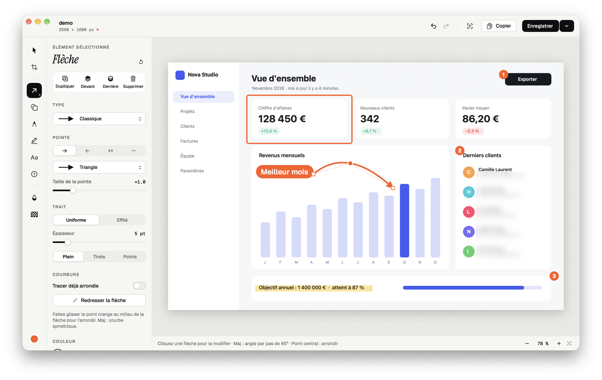
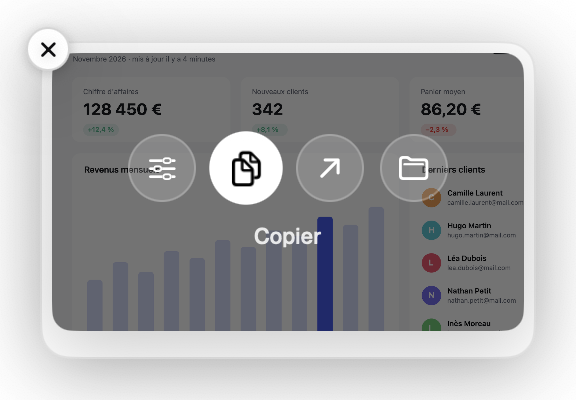
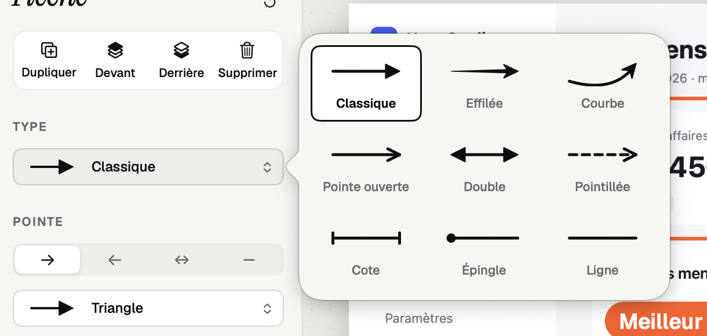
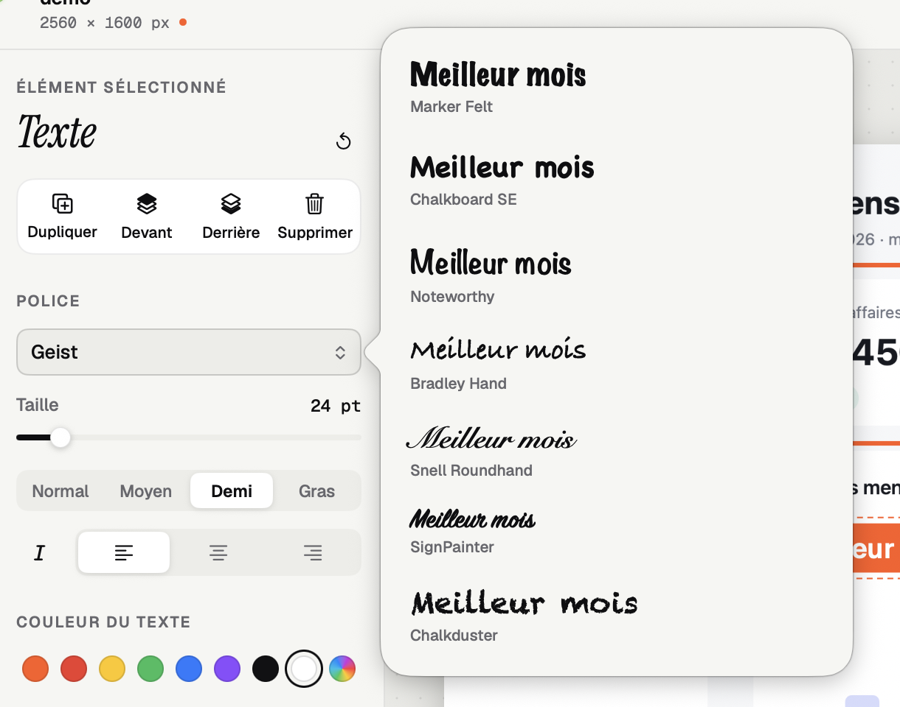
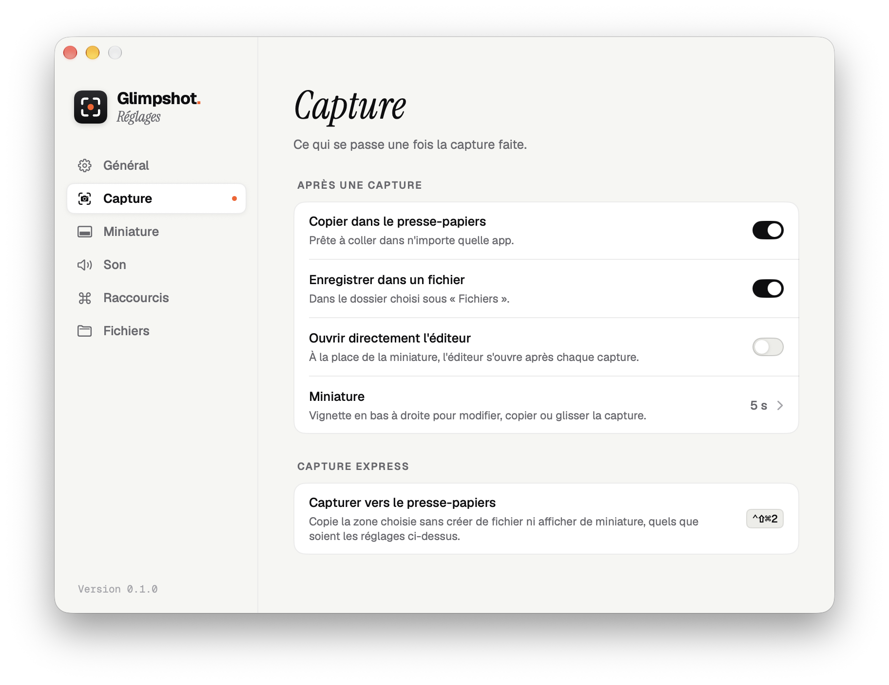
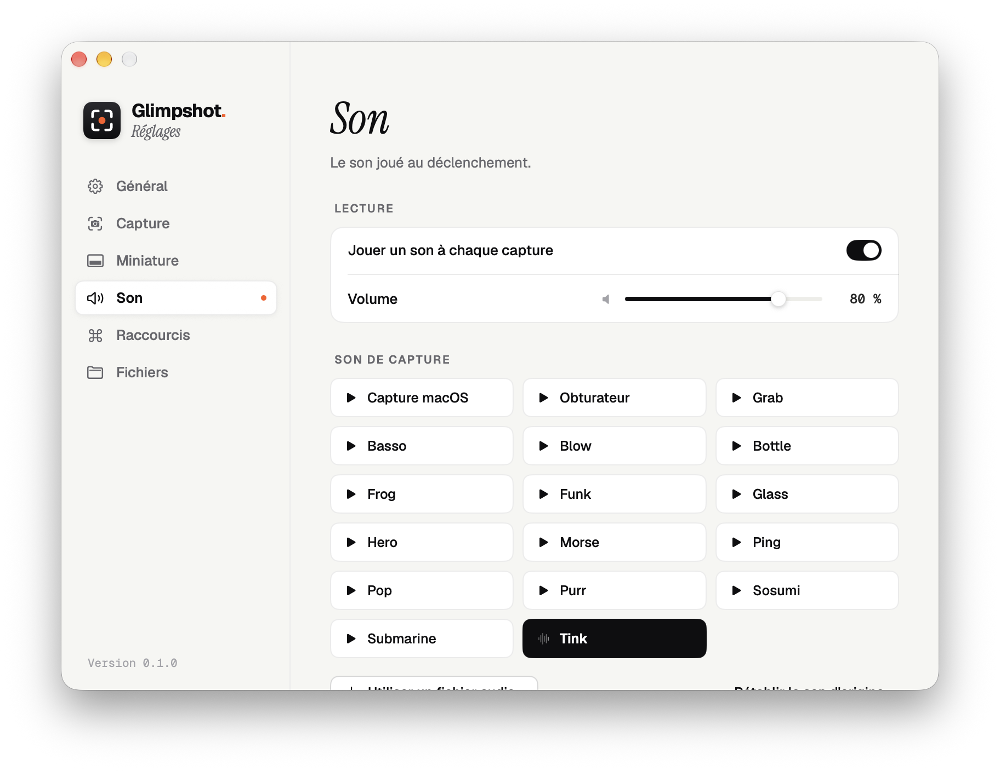

<p align="center">
  <picture>
    <source media="(prefers-color-scheme: dark)" srcset="images/banner-dark.png">
    
  </picture>
</p>

<p align="center">
  <b>L'outil de capture d'écran pour macOS, sobre et rapide.</b><br>
  Une zone, une fenêtre ou l'écran entier ; des annotations soignées ; le texte d'une image en un raccourci.<br>
  Tout reste sur votre Mac.
</p>

<p align="center">
  <a href="https://github.com/takumaterasu/glimpshot/releases/latest/download/Glimpshot.dmg"></a>
</p>

<p align="center">
  
  
  
  
</p>

<p align="center">
  
</p>

---

## Sommaire

- [Ce que fait Glimpshot](#ce-que-fait-glimpshot)
- [Installation](#installation) — à lire, macOS demande deux autorisations
- [Tutoriel](#tutoriel)
- [Raccourcis](#raccourcis)
- [Questions fréquentes](#questions-fréquentes)

---

## Ce que fait Glimpshot

### Cinq façons de capturer

| | Capture | Raccourci |
|---|---|---|
| ⬚ | **Une zone** — glissez pour choisir | <kbd>⇧</kbd> <kbd>⌘</kbd> <kbd>2</kbd> |
| ▭ | **Une fenêtre** — cliquez dessus, même partiellement cachée | <kbd>⌥</kbd> <kbd>⇧</kbd> <kbd>⌘</kbd> <kbd>2</kbd> |
| ▣ | **L'écran entier** — celui sous le curseur | <kbd>⇧</kbd> <kbd>⌘</kbd> <kbd>1</kbd> |
| ⌗ | **Du texte** — le texte ou le QR code d'une zone est copié, sans image | <kbd>⌥</kbd> <kbd>⇧</kbd> <kbd>⌘</kbd> <kbd>1</kbd> |
| ⧉ | **Vers le presse-papiers** — une zone copiée, sans fichier | <kbd>⌃</kbd> <kbd>⇧</kbd> <kbd>⌘</kbd> <kbd>2</kbd> |

Tous les raccourcis se changent dans les réglages.

### Une miniature, juste ce qu'il faut



Après chaque capture, une vignette apparaît en bas à droite de l'écran, le temps que vous choisissez.

- **Survolez-la** : elle se met en pause et propose *Modifier*, *Copier*, *Ouvrir* et *Afficher dans le Finder*.
- **Cliquez dessus** pour l'ouvrir dans l'éditeur.
- **Glissez-la** directement dans un e-mail, une conversation ou un document.

<br clear="right">

### Un éditeur complet, à la manière de Photoshop

Outils à gauche, réglages juste à côté, et tout ce qu'on attend d'un vrai éditeur : annuler et rétablir, poignées de redimensionnement, Maj pour contraindre, zoom.

- **Flèches** : neuf types, sept pointes, devant, derrière ou des deux côtés, corps uniforme ou effilé, en tirets ou en points. Le point central se tire pour **arrondir** la flèche.
- **Formes** : rectangle, ellipse, triangle, losange, étoile et bulle, avec contour, remplissage et coins arrondis.
- **Texte** : 23 polices, avec un aperçu de votre propre texte ; fond en halo, en bloc ou en pastille.
- **Crayon et surligneur**, **numéros d'étape** qui se suivent tout seuls.
- **Flou et pixellisation** pour masquer une adresse, un nom, un montant.
- **Recadrage** libre ou aux formats 1:1, 4:3, 3:2 et 16:9.
- **Reconnaissance de texte** : copiez le texte de n'importe quelle capture.

<table>
  <tr>
    <td width="50%"></td>
    <td width="50%"></td>
  </tr>
  <tr>
    <td align="center"><sub>Les types de flèches, illustrés</sub></td>
    <td align="center"><sub>Chaque police montrée avec votre texte</sub></td>
  </tr>
</table>

### Des réglages clairs

<table>
  <tr>
    <td width="50%"></td>
    <td width="50%"></td>
  </tr>
  <tr>
    <td align="center"><sub>Ce qui se passe après une capture</sub></td>
    <td align="center"><sub>Le son de capture, à écouter et choisir</sub></td>
  </tr>
</table>

---

## Installation

> **En bref** : glissez l'app dans Applications, autorisez-la une première fois dans les Réglages Système, puis autorisez l'enregistrement de l'écran. Comptez deux minutes.

Glimpshot n'est pas distribué par l'App Store. macOS demande donc de confirmer, **une seule fois**, que vous voulez bien l'ouvrir.

### 1. Télécharger et copier l'app

1. Téléchargez **[Glimpshot.dmg](https://github.com/takumaterasu/glimpshot/releases/latest/download/Glimpshot.dmg)**.
2. Ouvrez le fichier téléchargé.
3. Glissez **Glimpshot** sur le dossier **Applications**.
4. Éjectez l'image disque (clic droit › *Éjecter*).

### 2. Autoriser l'ouverture (une seule fois)

1. Ouvrez **Applications** et double-cliquez sur **Glimpshot**.
   macOS affiche *« Apple n'a pas pu confirmer que « Glimpshot » ne contient pas de logiciel malveillant… »*.
   Cliquez sur **Terminé** (surtout pas *Placer dans la corbeille*).
2. Ouvrez **Réglages Système** ( › Réglages Système…).
3. Dans la barre latérale, choisissez **Confidentialité et sécurité**.
4. Faites défiler jusqu'à la rubrique **Sécurité**. Vous y voyez *« « Glimpshot » a été bloqué afin de protéger votre Mac »*.
5. Cliquez sur **Ouvrir quand même**, puis confirmez avec votre mot de passe ou Touch ID.
6. Dans la fenêtre qui suit, cliquez encore sur **Ouvrir quand même**.

Glimpshot s'ouvre : son icône, un viseur avec un point, apparaît dans la **barre des menus**, en haut à droite de l'écran (pas dans le Dock, c'est normal).

<details>
<summary><b>Méthode alternative, avec le Terminal</b></summary>

<br>

Si vous êtes à l'aise avec le Terminal, cette commande retire le blocage en une fois :

```bash
xattr -dr com.apple.quarantine /Applications/Glimpshot.app
```

Ouvrez ensuite Glimpshot normalement.

</details>

### 3. Autoriser l'enregistrement de l'écran

Pour capturer, Glimpshot doit pouvoir lire l'écran. macOS le demande à la première capture :

1. Faites une capture, par exemple <kbd>⇧</kbd> <kbd>⌘</kbd> <kbd>2</kbd>.
2. Dans la fenêtre *« « Glimpshot » souhaite enregistrer le contenu de votre écran »*, cliquez sur **Ouvrir les Réglages Système**.
3. Dans **Confidentialité et sécurité › Enregistrement de l'écran et de l'audio système**, **activez Glimpshot**.
4. Cliquez sur **Quitter et rouvrir** quand macOS le propose.

C'est terminé. Vous pouvez vérifier à tout moment dans Glimpshot › **Réglages… › Général › Autorisations**.

> [!NOTE]
> macOS peut, de temps en temps, vous redemander de confirmer qu'une app a toujours le droit d'enregistrer l'écran. Cliquez simplement sur **Continuer à autoriser**.

### Mettre à jour

Téléchargez la nouvelle version, glissez-la dans Applications et choisissez **Remplacer**. Vos réglages sont conservés, et l'autorisation d'enregistrement de l'écran aussi. Si macOS bloque de nouveau l'ouverture, refaites l'étape 2.

---

## Tutoriel

### Première capture

1. Appuyez sur <kbd>⇧</kbd> <kbd>⌘</kbd> <kbd>2</kbd> : l'écran se fige et le curseur devient une croix.
2. **Glissez** pour choisir une zone. Les dimensions s'affichent en pixels.
   - <kbd>Espace</kbd> passe en mode **fenêtre** : survolez une fenêtre et cliquez.
   - <kbd>Échap</kbd> annule.
3. Relâchez : la capture est **copiée** et **enregistrée** dans *Images › Glimpshot*, et la miniature apparaît.

Tout passe aussi par l'icône de la barre des menus, si vous préférez la souris.

### Annoter une capture

1. Cliquez sur la miniature : l'éditeur s'ouvre.
2. Choisissez un outil dans la colonne de gauche (ou tapez sa lettre, indiquée en survolant l'outil).
3. Réglez couleur, épaisseur et style dans le panneau juste à côté. Ces réglages sont mémorisés pour les prochaines fois.
4. Dessinez sur l'image. Pour modifier un élément, **cliquez dessus** : ses poignées et ses réglages réapparaissent.
5. **Copier** (<kbd>⌘</kbd> <kbd>C</kbd>) pour coller ailleurs, ou **Enregistrer** (<kbd>⌘</kbd> <kbd>S</kbd>).

**Arrondir une flèche** : sélectionnez-la et tirez le **point orange** au milieu. Avec <kbd>Maj</kbd>, la courbe reste symétrique.

**Masquer une information** : outil **Flou** (<kbd>B</kbd>) ou **Pixellisation** (<kbd>X</kbd>), puis glissez sur la zone.

**Numéroter des étapes** : outil **Numéro** (<kbd>N</kbd>), puis un clic par étape. Les numéros se suivent tout seuls.

### Copier le texte d'une image

- Sur l'écran : <kbd>⌥</kbd> <kbd>⇧</kbd> <kbd>⌘</kbd> <kbd>1</kbd>, puis choisissez la zone. Le texte (ou le lien d'un QR code) est dans le presse-papiers.
- Dans l'éditeur : le bouton **Copier le texte** en haut de la fenêtre.

### Personnaliser

Glimpshot › **Réglages…** (<kbd>⌘</kbd> <kbd>,</kbd>) :

| Section | Ce qu'on y règle |
|---|---|
| **Capture** | Copier, enregistrer, ouvrir directement l'éditeur |
| **Miniature** | L'afficher ou non, sa durée (2 à 30 s, ou jusqu'à fermeture) |
| **Son** | Le son de capture, son volume, ou votre propre fichier audio |
| **Raccourcis** | Tous les raccourcis, en cliquant puis en tapant la combinaison |
| **Fichiers** | Le dossier d'enregistrement, PNG ou JPEG, la qualité |
| **Général** | Le lancement à l'ouverture de session, les autorisations |

---

## Raccourcis

### Dans l'éditeur

| Outil | Touche | | Action | Raccourci |
|---|---|---|---|---|
| Sélection | <kbd>V</kbd> | | Annuler | <kbd>⌘</kbd> <kbd>Z</kbd> ou <kbd>⌃</kbd> <kbd>Z</kbd> |
| Recadrer | <kbd>C</kbd> | | Rétablir | <kbd>⌘</kbd> <kbd>Y</kbd> ou <kbd>⌃</kbd> <kbd>Y</kbd> |
| Flèche | <kbd>A</kbd> | | Dupliquer | <kbd>⌘</kbd> <kbd>D</kbd> |
| Forme | <kbd>U</kbd> | | Supprimer | <kbd>⌫</kbd> |
| Crayon | <kbd>P</kbd> | | Déplacer finement | <kbd>←</kbd> <kbd>↑</kbd> <kbd>→</kbd> <kbd>↓</kbd> (avec <kbd>Maj</kbd> : ×10) |
| Surligneur | <kbd>H</kbd> | | Zoom | <kbd>⌘</kbd> <kbd>+</kbd> / <kbd>⌘</kbd> <kbd>−</kbd>, ou pincer |
| Texte | <kbd>T</kbd> | | Ajuster à la fenêtre | <kbd>⌘</kbd> <kbd>0</kbd> |
| Numéro | <kbd>N</kbd> | | Déplacer la vue | <kbd>Espace</kbd> + glisser |
| Flou | <kbd>B</kbd> | | Copier l'image | <kbd>⌘</kbd> <kbd>C</kbd> |
| Pixellisation | <kbd>X</kbd> | | Enregistrer | <kbd>⌘</kbd> <kbd>S</kbd> |

**En dessinant** : <kbd>Maj</kbd> contraint (flèches à 45°, carrés et cercles parfaits, lignes droites, déplacement sur un axe) et <kbd>⌥</kbd> dessine depuis le centre.

---

## Questions fréquentes

<details>
<summary><b>Je ne trouve pas Glimpshot après l'avoir ouvert.</b></summary>

<br>
C'est une app de la barre des menus : cherchez le viseur avec un point, en haut à droite de l'écran. Elle n'apparaît pas dans le Dock.
</details>

<details>
<summary><b>macOS dit que l'app est endommagée ou ne peut pas être ouverte.</b></summary>

<br>
C'est le blocage des apps hors App Store. Suivez l'<a href="#2-autoriser-louverture-une-seule-fois">étape 2 de l'installation</a> ou la méthode avec le Terminal.
</details>

<details>
<summary><b>Mes captures sont noires ou ne montrent que le fond d'écran.</b></summary>

<br>
L'autorisation d'enregistrement de l'écran manque. Voir l'<a href="#3-autoriser-lenregistrement-de-lécran">étape 3</a>, puis quittez et rouvrez Glimpshot.
</details>

<details>
<summary><b>Un raccourci ne fonctionne pas.</b></summary>

<br>
Une autre app l'utilise peut-être déjà (un triangle orange le signale dans Réglages › Raccourcis). Choisissez une autre combinaison. Les raccourcis de capture de macOS (<kbd>⇧</kbd> <kbd>⌘</kbd> <kbd>3</kbd>, <kbd>4</kbd>, <kbd>5</kbd>) se désactivent dans Réglages Système › Clavier › Raccourcis clavier › Captures d'écran.
</details>

<details>
<summary><b>Mes captures sont-elles envoyées quelque part ?</b></summary>

<br>
Non. Tout se fait sur votre Mac, y compris la reconnaissance de texte. Glimpshot ne se connecte à aucun serveur.
</details>

<details>
<summary><b>Comment désinstaller Glimpshot ?</b></summary>

<br>
Quittez-le (icône de la barre des menus › Quitter Glimpshot), puis mettez <code>Glimpshot.app</code> à la corbeille depuis le dossier Applications. Vos captures restent dans <i>Images › Glimpshot</i>.
</details>

---

<p align="center">
  <sub>Glimpshot · Typographies <a href="https://vercel.com/font">Geist</a> et <a href="https://fonts.google.com/specimen/Instrument+Serif">Instrument Serif</a>, sous licence SIL Open Font.</sub>
</p>
